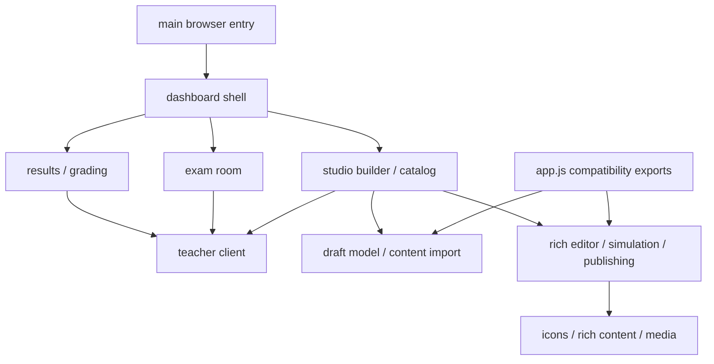

# Phương án tái cấu trúc frontend Webtest34

## Cập nhật triển khai — 30/10/2026

- Nhánh `refactor/frontend-architecture-plan`: #18 và #20 đã đóng; #21 đã có implementation commit, issue vẫn mở.
- #22 đã triển khai và kiểm chứng local: 521/521 frontend tests pass; browser smoke 3 viewport pass. Xem [báo cáo #22](ISSUE_22_READ_CONCURRENCY_VERIFICATION.md) để biết phạm vi, review và giới hạn kiểm chứng.
- Tiếp theo: #23 (SSE/reconnect/REST fallback), rồi #24 (tích hợp lifecycle và rollback). Chưa merge vào main.
- Nội dung khảo sát và checklist bên dưới là baseline ban đầu; không coi toàn bộ bước 0–2 hoàn tất trước khi nghiệm thu #24.

Ngày khảo sát: 28/10/2026, Asia/Ho_Chi_Minh. Trạng thái: đề xuất để review, chưa triển khai.

**Goal:** Giảm độ phức tạp, làm rõ quyền sở hữu state và lifecycle, giữ hành vi và giao diện hiện tại.

**Architecture:** Tách module theo tính năng và interface trước; chuyển TypeScript từng phần sau khi có seam ổn định. Vue + TypeScript + Vite là ứng viên thử nghiệm cho vùng soạn đề, chưa phải quyết định chuyển toàn bộ sản phẩm.

**Tech Stack:** Hiện tại Vanilla JS/ESM, HTML/CSS, node:test, static hosting. TypeScript và framework dưới đây chỉ là đề xuất.

**Spec:** Yêu cầu khảo sát do người dùng cung cấp; AGENTS.md hai repo; [GLOSSARY](../../GLOSSARY.md) và [DESIGN_SYSTEM](../../DESIGN_SYSTEM.md). Tài liệu nghiệp vụ backend được liệt kê bên dưới.

## 1. Phạm vi, Git và giới hạn

- Frontend: `webtest34-learning-frontend`, HEAD `0fd6274`, xuất phát từ `feature/test-studio`; tạo nhánh mới `refactor/frontend-architecture-plan` trước mọi ghi file. Working tree frontend sạch khi bắt đầu.
- Backend: `webtest34-learning-platform`, HEAD `f52af88`, giữ `feature/test-studio`, chỉ đọc/chạy kiểm tra. Có nhiều file untracked từ trước; không đọc nội dung dữ liệu riêng và không thay đổi chúng.
- Chỉ thêm tài liệu này; không đổi source, dependency, build config, AGENTS.md, dữ liệu hoặc schema. Không commit/push/merge.
- Không đọc file .env, không dùng danh tính/token thật, không gọi API production. Không khảo sát nội dung answer keys/private rubrics.
- Các mốc code dưới đây trỏ tới working tree khảo sát tại HEAD trên, không phải cam kết ổn định sau refactor.
- Đã đọc hướng dẫn workspace/hai repo, GLOSSARY, DESIGN_SYSTEM; Teacher Dashboard spec và Test Studio management/simulation spec. Áp dụng codebase-design, brainstorming và writing-plans ở mức phù hợp với yêu cầu chỉ lập tài liệu. Chưa phải kế hoạch được duyệt để thực thi.

## 2. Hiện trạng đã xác minh

### 2.1. Kích thước và entry point

Số dòng vật lý được đếm bằng tách newline, bao gồm dòng trắng, bỏ phần tử trống do newline cuối file. Byte là UTF-8 trên đĩa, không phải kích thước truyền nén. `Measure-Object -Line` loại dòng trống nên không dùng cho bảng cuối.

| File trong frontend | Dòng | Byte | Vai trò thực tế |
| --- | ---: | ---: | --- |
| `term-tests/teacher-dashboard/app.js` | 16.821 | 812.908 | Dashboard, Test Studio, simulation, chấm và vận hành |
| `term-tests/teacher-dashboard/styles.css` | 10.174 | 218.434 | CSS dùng chung cho các vùng trong dashboard |
| `term-tests/webtest-34-demo/index.html` | 2.595 | 146.710 | Canonical renderer, gồm script inline lớn |
| `term-tests/webtest-34-demo/dynamic-test.css` | 2.214 | 50.939 | CSS canonical renderer |

- `teacher-dashboard/index.html:15` tải styles.css; `:728` tải app.js bằng module script. Test Studio nằm trong dashboard, chưa có ứng dụng build riêng.
- `webtest-34-demo/index.html:9–21` tải config, các script shared và dynamic-test.css; `:599–2593` chứa script inline cho trải nghiệm học viên. Tên thư mục có “demo” nhưng AGENTS.md xác nhận đây là renderer canonical; không được xếp vào code bỏ đi.
- `index.html:18–21` giữ fragment khi redirect tới dashboard; `term-tests/webtest-34/test-1/index.html:19–22` giữ fragment khi redirect tới canonical renderer. Token học viên phải tiếp tục nằm trong fragment.
- Landing page `term-tests/webtest-34/index.html` là màn chọn bài theo bản đồ AGENTS.md. Các entry theo bài là adapter điều hướng, không phải lý do xây thêm renderer.
- Trong các file JS/CSS của `term-tests`, hai file dashboard lớn vượt trội; các file nhỏ như `exam-room-sse.js` và `portal-sync-view.js` đã là seam hữu ích, không cần tách tiếp vì mục tiêu số dòng.
- Chưa kiểm kê toàn bộ generated/vendor/legacy ngoài frontend canonical. Không có kết luận xóa file nào; không sửa frontend legacy ở workspace cha.

### 2.2. Công cụ, deploy và test

- `package.json:1` có type module; start/dev dùng `node serve.mjs 8034 127.0.0.1`; test dùng `node --test tests/*.test.mjs`. Không có scripts build/typecheck, dependencies hay lockfile tìm được trong phạm vi frontend.
- `.github/workflows/pages.yml:1`: push main hoặc workflow_dispatch, Node 22, chạy npm test rồi upload nguyên thư mục `.` lên Pages. Chưa có build artifact riêng; branch khảo sát không được tự deploy.
- `serve.mjs:1`: static server có MIME JS/MJS, proxy `/api`/`internal`/health sang local backend, fallback asset từ dashboard sang renderer và HTTP Range cho audio. Vite dev server không tự bảo toàn những hợp đồng này.
- Môi trường khảo sát Node `v24.19.0`; backend yêu cầu Node >=24 <25. Không suy ra frontend CI Node 22 đã chạy từ kết quả local Node 24.
- Có 88 file `tests/*.test.mjs`; 63 file có chuỗi import `teacher-dashboard/app.js`, 14 file tham chiếu đường dẫn styles.css. Đây là đếm reference, không phải phân loại đầy đủ chất lượng test.
- `tests/test-studio-unsaved-changes-guard.test.mjs:1` kiểm tra guard và thao tác với DOM giả. `tests/test-studio-canonical-exam-simulation.test.mjs:1` vừa kiểm tra markup vừa đọc CSS bằng chuỗi. Các test này hữu ích nhưng không chứng minh layout/focus/audio thực trong browser.

### 2.3. Trách nhiệm, state và luồng gọi

| Cụm code app.js | Dẫn chứng | Vấn đề/kết luận |
| --- | --- | --- |
| Biến thể câu, CSV, format, icon | :12, :499, :565–1022 | Logic độc lập trộn với entry browser; có thể tách theo nghiệp vụ import nội dung, icon |
| URL/auth, kết quả, exam room | :1039–1583 | Nhiều interface công khai; giữ tương thích import trong giai đoạn chuyển |
| Unsaved guard, catalog/modal | :1594–2221 | Guard dùng module-global; catalog và dialog đang sống cùng file |
| Media URL/audio, rich content | :2308–3324 | Logic chuyển đổi, DOM editor và audio lifecycle bị gom chung |
| Cấu trúc đề và batch | :3325–4126 | Các thao tác vị trí/span/exercise là seam phù hợp để kiểm thử hành vi |
| Test Builder | :4127–12888 | Khoảng 8.762 dòng trong một hàm: state, render, drag/drop, rich editor, sandbox, simulation, save/publish/delete |
| Chấm/định dạng kết quả | :12891 trở đi | Cần tách view model kết quả khỏi thao tác DOM và request |
| Bootstrap/dashboard controller | :13475–16821 | Auth, URL, tải dữ liệu, SSE, polling và điều hướng gắn với document |

State hiện tại:

- Builder sở hữu `draftState` trong closure (`:4134`), clone blocks/grading metadata và render lại qua hàm `render` (`:5805`). Nhiều handler sửa trực tiếp draft, ví dụ di chuyển block `:10294` và cập nhật version sau lưu `:10421`. Đổi sang state bất biến ngay khi di chuyển file sẽ là thay đổi logic, phải tách riêng.
- Guard đăng ký tại `:4260`, hủy trên một số đường thoát tại `:6684`, `:12482`; global guard tại `:1594`. Cần kiểm thử đầy đủ đường chuyển tab, mở đề khác, save lỗi và đóng cửa sổ trước khi đổi interface.
- Dashboard sở hữu state từ URL (`:14152`), alias selectedAssignmentId (`:14153`), session token trong sessionStorage (`:14187`), controller SSE (`:14188`) và currentAttemptDetail (`:14150`). Không chuyển token sang URL hoặc global store công khai.
- Dashboard có request chung quanh `:14230`, nhưng sandbox/publish (`:10227`, `:12106`, `:12325`) và chấm/làm lại (`:16017`, `:16473`) còn fetch trực tiếp. Cần thống nhất xử lý lỗi/auth sau bước di chuyển giữ nguyên behavior; không tự thêm retry cho thao tác ghi.
- Luồng hiện tại: HTML → app import → `startDashboard()` nếu có document ở cuối file → auth/scope → loadClasses/loadAssignments/loadResults → render → handlers gọi backend. Khi test thiết lập document trước import có nguy cơ bootstrap ngoài ý muốn; đây là điều kiện cần bảo vệ, không khẳng định đã gây lỗi.
- Canonical học viên có state riêng (`webtest-34-demo/index.html:704`), request (`:778`), heartbeat (`:829`), SSE (`:840`), audio checkpoints (`:1831`), visibility/beforeunload (`:2022`, `:2026`, `:2455`). Không gom state học viên với state simulation của giáo viên.

### 2.4. Lifecycle, duplication và CSS

**Đã thấy trong code:** document mouseup/click listener được đăng ký bên trong render builder (`app.js:9507`, `:12873`). Các đoạn đăng ký này không trả disposer; cuối builder chỉ gọi render rồi kết thúc (`:12887`). Polling cuối startDashboard chạy mỗi 30 giây; SSE có AbortController (`:14342`). Không được kết luận toàn hệ thống thiếu cleanup: batch modal có removeEventListener (`:3846`).

**Giả thuyết cần tái hiện:** render/mount nhiều lần có thể tích lũy document handler; request cũ có thể ghi đè dữ liệu sau đổi scope. Chưa đo số handler/heap và chưa tái hiện race bằng browser. Đây là test cần thêm, không phải lỗi đã xác nhận bằng runtime.

Simulation nằm trong builder (`:10464` trở đi), canonical học viên lại render trong HTML riêng. Audio khởi tạo có hai đường `renderStrictCandidateAudioDock:2384` và `initStrictCandidateAudioDocks:2509`. Có các trách nhiệm tương tự; chưa đủ bằng chứng để thay bằng một implementation chung ngay. Khác biệt giữa preview có dữ liệu soạn đề và học viên chỉ nhận public definition là trust boundary phải giữ.

CSS có 243 lần `!important`, 22 `@media` trong styles.css; dynamic-test.css có 240 lần `!important`, 5 `@media`. Đây là đếm văn bản, không phải số lỗi cascade. Ví dụ global button tại `styles.css:34`, builder toolbar tại `:3053` và khai báo lại tại `:7788`; các phần override/reset sau `:9405`, modal sau `:9910`, Portal sau `:10165`. Có nhiều :root (`:2`, `:3612`). Di chuyển theo nhóm selector một cách máy móc sẽ thay thứ tự thắng/thua.

Đã thấy hardcoded màu/radius trong global button (`styles.css:34`) và inline markup (`app.js:15286`). Ghi nhận là nợ design system; không sửa đồng thời với di chuyển code. Selector tạo động và trạng thái collapse/drag khiến static search chưa đủ chứng minh CSS không dùng. Chưa có computed-style audit hoặc specificity graph toàn bộ.

## 3. Các vấn đề ưu tiên

| Ưu tiên | Vấn đề | Hệ quả | Hướng xử lý |
| --- | --- | --- | --- |
| P1 | Builder closure rất lớn | Sửa một interaction phải hiểu nhiều state/handler | Tách model/import/editor/simulation/publish theo interface |
| P1 | Lifecycle không có interface thống nhất | Khó chứng minh mount/unmount sạch | Characterization trước, sau đó mount → dispose rõ ràng |
| P1 | Test/import gắn với app.js | Di chuyển code có thể làm test đứt dù behavior đúng | Facade tạm giữ named exports; chuyển test dần về seam thật |
| P1 | CSS phụ thuộc cascade và override | Chia CSS dễ đổi giao diện | Đóng băng thứ tự trước, cleanup sau khi có ảnh baseline |
| P2 | Request/auth/state phân tán | Khó kiểm tra lỗi, race và scope | Interface request và feature owner rõ ràng |
| P2 | Simulation/canonical có trách nhiệm giống nhau | Nguy cơ drift, rủi ro trộn private/public | Chỉ chia sẻ renderer public khi đã có parity tests |
| P2 | Thiếu build/typecheck | Khó áp dụng TS/framework an toàn | Thêm tooling theo bước riêng và kiểm tra artifact |

## 4. So sánh công nghệ và lựa chọn

| Tiêu chí | A. JS ESM chia module | B. TypeScript + DOM hiện tại | C. Vue + TS + Vite |
| --- | --- | --- | --- |
| Độ phức tạp state/lifecycle | Cải thiện nếu interface tốt; quản lý thủ công | Như A, thêm kiểm tra kiểu | Hỗ trợ reactive state/lifecycle; vẫn cần thiết kế owner |
| Kiểm thử | Giữ node:test thuận lợi | Thêm typecheck và TS test loading | Thêm kiểm thử Vue và browser; test DOM giả cần chuyển |
| Backend | Giữ contract | Giữ contract; typed DTO không thay runtime validation | Giữ contract, không cần đổi Express/Postgres |
| Static hosting | Giữ deploy hiện tại | .ts phải emit thành JS nếu browser dùng | Build ra static artifact, cần base/MPA đúng |
| UI/rich HTML | Ít thay đổi markup nhất | Tương tự A | Có thể giữ CSS, nhưng DOM/render/editor integration cần kiểm tra |
| Dependency/học tập | Thấp tương đối | Trung bình; TS và compile path | Cao hơn; Vue, compiler/plugin, typecheck SFC, testing |
| Bundle/thời gian tải | Chưa đo; nhiều module có thêm request | TS không tự giảm JS tải về | Thêm runtime; lazy loading có thể bù, phải đo |
| Accessibility | Phải kiểm chứng | Phải kiểm chứng | Framework không tự bảo đảm focus/keyboard |
| Chuyển dần/rollback | Dễ nhất | Khả thi sau tách module | Khả thi theo root riêng; khó nếu hai bên cùng ghi DOM |

**Khuyến nghị của người lập phương án:** A là bước chuẩn bị bắt buộc; B là đích ưu tiên ngắn/trung hạn. C là ứng viên có điều kiện cho vùng Test Studio, quyết định bằng pilot. Không đề nghị rewrite Dashboard và phòng thi cùng lúc.

Lý do: vấn đề lớn đã quan sát nằm ở phân chia trách nhiệm và lifecycle; TypeScript không tự chia closure, framework không tự sửa quyền sở hữu state. B bổ sung hợp đồng cho draft/item/response mà chưa phải đổi toàn bộ DOM. Vue được chọn làm ứng viên C vì có thể mount thành vùng độc lập và có lifecycle rõ; đây là suy luận thiết kế của agent, chưa dựa trên kinh nghiệm của đội hoặc benchmark. Không có bằng chứng React/Svelte không phù hợp; chỉ chưa có lý do repo-specific để mở rộng nghiên cứu sang mọi framework.

Teacher Dashboard giữ DOM modules trước; Test Studio có thể tiến tới Vue nếu pilot đạt; CBT giữ canonical renderer và tách JS trước khi cân nhắc TS. Dùng cùng contract public definition và token CSS, không dùng chung session/private authoring state. Hai cách render trong thời gian chuyển sẽ tăng công bảo trì: phải đặt thời hạn đánh giá sau pilot và tránh xây thêm feature song song ở cả hai implementation.

### Cơ sở tài liệu chính thức, kiểm tra ngày 28/10/2026

- TS cho phép JS/TS cùng tồn tại và migration dần: [Migration guide](https://www.typescriptlang.org/docs/handbook/migrating-from-javascript.html), [allowJs](https://www.typescriptlang.org/tsconfig/allowJs.html), [checkJs](https://www.typescriptlang.org/tsconfig/checkJs.html). Đây là tính khả thi công cụ, không phải bằng chứng code hiện tại đã typecheck.
- Vue dùng được theo từng vùng hoặc ứng dụng lớn: [Ways of using Vue](https://vuejs.org/guide/extras/ways-of-using-vue); [unmount](https://vuejs.org/api/application.html#app-unmount) hỗ trợ teardown ứng dụng, nhưng external timer/listener vẫn cần cleanup do người triển khai quản lý.
- Build và typecheck là hai việc riêng trong [Vue TypeScript guidance](https://vuejs.org/guide/typescript/overview.html) và [Vite features](https://vite.dev/guide/features.html). Cần tsc/vue-tsc riêng, không xem build thành công là kiểm tra kiểu thành công.
- Static deployment cần cấu hình base theo domain/project path: [Vite Pages deployment](https://vite.dev/guide/static-deploy.html); nhiều entry HTML được hỗ trợ trong [Vite build guide](https://vite.dev/guide/build.html#multi-page-app).

Chưa chọn/pin phiên bản package. Trước cài đặt phải kiểm tra engines, plugin compatibility, browsers target với phiên bản cụ thể và Node CI 22/backend 24; không chép cấu hình theo một major khác. Chưa có bundle/performance measurement, không cam kết nhanh hơn.

## 5. Kiến trúc đích và interface đề xuất

Đây là tên/đường dẫn dự kiến, chưa tạo. Trong giai đoạn A dùng .js; chỉ đổi module đã có seam ổn định sang .ts ở giai đoạn B.

```text
term-tests/teacher-dashboard/
  app.js                         # facade tương thích named exports, không bootstrap
  main.js                        # entry browser duy nhất
  shell/dashboard.js             # auth, URL, scope và mount/dispose tính năng
  api/teacher-client.js           # HTTP/auth/error; không quyết định quyền nghiệp vụ
  results/results-view.js        # bảng, lọc, phân trang trong scope
  grading/attempt-review.js      # chấm nháp/hoàn tất/công bố kết quả
  exam-room/exam-room.js         # SSE, polling và teardown
  exam-room-sse.js                # giữ parser hiện có
  portal-sync-view.js             # giữ mapping hiện có
  studio/catalog.js              # danh mục, mở đề, tạo/xóa qua backend
  studio/builder.js              # orchestration editor, state và commands
  studio/draft-model.js           # draft/items/exercises/span/resequence
  studio/content-import.js        # CSV và biến thể nội dung, không DOM
  studio/publishing.js            # preview tác động, xác nhận, gửi backend
  studio/simulation.js            # preview state riêng, không quyết định điểm thật
  studio/rich-editor.js           # contenteditable và selection lifecycle
  studio/media.js                # URL media, audio lifecycle của preview
  ui/icons.js                    # ICONS/renderSvgIcon
  ui/rich-content.js             # sanitize/render contract, không chứa đáp án
  navigation/unsaved-changes.js   # guard và dialog, owner được đăng ký/hủy
  styles.css                     # entry CSS tương thích giai đoạn đầu
  styles/                        # chỉ tạo sau khi lập bản đồ thứ tự cascade
    tokens.css
    base.css
    dashboard.css
    studio.css
    simulation.css
    compatibility.css            # override còn lại, có kế hoạch thu hồi
term-tests/webtest-34-demo/
  index.html                     # tiếp tục canonical, cấu hình thứ tự tải giữ nguyên
  runtime.js                     # tách script inline giữ behavior trước
  runtime/                       # tách request/state/audio/exam khi có test
```

Không tạo tất cả thư mục ngay: mỗi bước chỉ tạo module mà code thực tế được chuyển vào. Portal mapping/SSE parser giữ nguyên nếu không có lý do di chuyển. Không tạo generic repository/store/event bus chung.



Quy tắc: module không import ngược facade/main/shell; shell truyền dependency cần thiết. Facade là ngoại lệ chuyển tiếp có thời hạn vì 63 test đang import app.js, không phải tầng kiến trúc lâu dài. Gỡ khi không còn consumer phụ thuộc; không thêm logic vào facade.

### Interface dự kiến

| Module | Interface | Owner/invariant |
| --- | --- | --- |
| content-import | Giữ tên/tham số/return hiện tại của parseCsvRows, parseVocabPairCsv và parser từng dạng | Pure, không fetch/document, không sửa dữ liệu đầu vào ngoài behavior đã ghi nhận |
| draft-model | createDraft(input), applyDraftCommand(draft, command), serializeDraft(draft) | Builder là owner duy nhất; command có loại cụ thể add/move/edit, không “update bất kỳ field” công khai |
| builder | mountBuilder(root, {data, client, navigation}): {dispose(), hasUnsavedChanges()} | Một mount/root; hủy handlers/editor/guard khi rời; lỗi lưu giữ draft |
| teacher-client | request(path, {method, body, signal}): Promise<unknown> | Inject fetch/base/auth; giữ mã lỗi/status, không log token; không retry ghi mặc định |
| shell | mountDashboard(root, dependencies): {dispose()} | Owner auth/scope/URL; đổi scope hủy hoặc bỏ response cũ theo generation |
| simulation | mountSimulation(root, publicDefinition, previewOptions): {dispose()} | State câu trả lời riêng; private authoring evaluation chỉ nằm trong luồng giáo viên được cấp quyền |
| rich-editor | mountRichEditor(root, {value, onChange}): {dispose(), getValue()} | Owner selection và listeners; không remount mỗi phím nhập |
| exam-room | mountExamRoom(root, {scope, client}): {dispose()} | Abort SSE, clear timer khi đổi assignment/rời màn hình |

Các tên mới là đề xuất; type cụ thể phải rút từ contract hiện hành khi triển khai. Không coi Promise<unknown> là DTO đã validate: decoder tại feature nhận unknown, kiểm schema/null/status trước khi render. Không tạo shared client chỉ để bọc fetch một dòng; giá trị của nó là thống nhất auth/error/cancellation.

### State, TS và CSS

- Shell sở hữu auth/scope/URL; builder sở hữu draft + dirty/save version; simulation sở hữu câu trả lời giả lập; học viên sở hữu attempt runtime riêng. Không singleton store xuyên các vùng.
- Bắt đầu allowJs với phạm vi include hẹp và JSDoc/checkJs cho module pilot. Module TS mới strict ngay; tăng coverage theo module, không tắt strict toàn repo vì legacy. Không dùng any/ts-ignore để xóa báo lỗi; unknown + narrowing ở network boundary.
- JS browser chưa qua build tiếp tục chạy bình thường. Trước import .ts từ browser phải có emit/build; Node 24 có thể xử lý một số TS không chứng minh browser/CI Node 22 hỗ trợ. Chọn một đường test TS rõ ràng (compile trước test hoặc loader được pin) trong bước tooling; không import .vue trực tiếp bằng node:test.
- CSS giai đoạn đầu giữ nguyên entry và thứ tự rule. Khi tách, có manifest thứ tự fragment nguyên bản; phần xen kẽ giữ trong compatibility thay vì gom tất cả theo selector làm thay cascade. Không đưa @layer hoặc scoped styles diện rộng trong cùng bước.
- Khi đổi sang build, CSS được bundler ghép theo thứ tự đã kiểm chứng; khi chưa build có thể dùng các link theo thứ tự hoặc @import tạm thời, phải đo request/FOUC. Không thêm import CSS khiến node:test đang import facade không chạy được.
- Cleanup token/radius/!important tách thành bước riêng có ảnh so sánh. Không tự sửa màu/font/hình học trong bước di chuyển giữ behavior.
- Nếu pilot Vue: framework sở hữu toàn bộ subtree được giao, legacy không innerHTML/rebind ở subtree đó; DOM shell thuộc legacy. Truyền props/callback đã định nghĩa, unmount trước xóa root. Contenteditable dùng adapter riêng, không v-html trực tiếp dữ liệu chưa sanitize; global event/timer được dispose rõ ràng.

## 6. Lộ trình có thể review/revert độc lập

Mọi bước dưới đây chưa được thực hiện. Công sức S/M/L là ước lượng tương đối của một người đã hiểu repo (S khoảng một phiên, M vài phiên, L nhiều phiên); không phải lịch giao hàng. Giả định có fixture tổng hợp và môi trường browser cục bộ. Mỗi bước có commit riêng khi người dùng chuyển sang giai đoạn triển khai.

### Bước 0 — Chốt baseline và bảo vệ hành vi (M)

- [ ] Frontend: thêm test hành vi cần thiết trong `tests/`, fixture tổng hợp và browser smoke cho vùng pilot; không thay app/CSS.
- [ ] Bảo vệ CSV quoting/BOM/newline, vị trí/span/exercise sau move, dirty/save lỗi, focus/scroll, mount nhiều lần, request trả ngược thứ tự.
- [ ] Chụp dashboard/builder/simulation/canonical ở 1440×900, 1024×768, 390×844; có modal, bảng dài, lỗi/empty/loading và keyboard.
- Interface: các export hiện tại và luồng người dùng. Dependency: không có; là tiên quyết cho bước 1–4.
- Nghiệm thu: test mới chạy trên hiện trạng; lỗi tái hiện được ghi riêng thay vì sửa lẫn. Ghi route/asset/browser và độ trễ thực đo.
- Rollback: revert chỉ test/fixture; không tác động dữ liệu. Rủi ro: DOM mock không phát hiện lỗi browser, nên browser smoke là điều kiện riêng.

### Bước 1 — Pilot tách module content import giữ behavior (S–M)

- [ ] Chuyển CSV/parser/template và biến thể nội dung từ `app.js:12`, `:565–1022` vào `studio/content-import.js`; chọn phạm vi CSV trước nếu variant phụ thuộc nhiều hơn dự kiến.
- [ ] app.js import nội bộ và re-export cùng named exports; không đổi return shape, ID generation, quy tắc normalization hoặc điểm.
- [ ] Test hành vi module mới; giữ test import facade để kiểm tương thích, sau đó chuyển consumer có kiểm soát.
- Interface: tên hiện tại parseCsvRows/parseSingleChoiceCsv/parseVocabPairCsv…; không tạo interface mới không cần thiết.
- Dependency: bước 0. Nghiệm thu: frontend suite xanh, bulk import thực tế bằng dữ liệu tổng hợp đúng, không có import ngược/cycle, module import được khi không có document.
- Rollback: revert commit di chuyển; không có API/schema change. Rủi ro: closure dependency ẩn; kiểm hết free variables trước khi cắt.

### Bước 2 — Entry và lifecycle rõ ràng (M)

- [ ] Tách bootstrap từ app.js sang `main.js`, cập nhật `teacher-dashboard/index.html:728`; tạo `shell/dashboard.js` và `navigation/unsaved-changes.js` khi chuyển owner tương ứng.
- [ ] Bước đầu giữ hành vi bằng mount wrapper; sửa lifecycle tích lũy listener/timer ở commit riêng sau khi có test tái hiện, không lẫn với relocation.
- [ ] Builder mount trả dispose; guard đóng/hủy đúng owner; exam room SSE/timer được hủy theo scope.
- Interface: mountDashboard/mountBuilder và disposer; export cũ được facade giữ đến khi chuyển xong consumers.
- Dependency: 0–1. Nghiệm thu: import facade không bootstrap kể cả có document; mount/dispose lặp 10 lần không tăng handler/timer còn hoạt động; đổi scope không nhận response cũ; dirty confirmation giữ đúng hành vi.
- Rollback: revert entry và lifecycle commits tương ứng, kiểm index tải app cũ đúng. Rủi ro: mất khởi tạo hoặc listener; static route và browser smoke bắt buộc.

### Bước 3 — Chia builder theo workflow (L, chia commit con)

- [ ] Từ `app.js:4127–12888`, lần lượt chuyển draft operations → rich editor/media → simulation → publishing sang các file ở cây đích; builder orchestration chuyển cuối.
- [ ] Giữ request/payload hiện tại khi chuyển; thống nhất client/error/auth ở commit sau với test contract.
- [ ] Chuyển results/grading và exam-room khỏi startDashboard sau builder, giữ portal-sync-view/exam-room-sse làm module hiện có.
- Interface: draft commands, mount editor/simulation, client injection; root owner không chồng lấn.
- Dependency: 2. Nghiệm thu từng commit: suite liên quan và toàn frontend xanh, không mất input/selection khi render/drag, thứ tự câu giữ, save/publish preview và cancel đúng; không đổi API hay quyền.
- Rollback: từng commit theo thứ tự ngược; không có migration dữ liệu. Rủi ro: closure state ngầm và private/public data lẫn; test payload/public rendering và browser smoke.

### Bước 4 — Tách CSS giữ cascade, rồi clean riêng (M–L)

- [ ] Lập rule-order/selector map cho styles.css và inline style trong builder; lưu ảnh/computed styles trước.
- [ ] Tách fragment giữ thứ tự; sửa entry styles.css hoặc link HTML có manifest kiểm được. Đảm bảo test đọc CSS chuyển sang kiểm artifact/rule contract thay vì xóa test cho pass.
- [ ] Cleanup token, override/!important và style trùng chỉ trong các commit sau, khi chứng minh thắng/thua tương đương.
- Interface: selector/class/DOM hiện tại. Dependency: 0 và owner DOM đã ổn định từ 2–3.
- Nghiệm thu: ảnh so sánh đủ viewport/states, typography/focus/scroll/audio dock không đổi, Pages paths đúng. Không dùng giảm số !important làm tiêu chí duy nhất.
- Rollback: revert nhóm fragment/link theo commit; không để entry trỏ fragment thiếu. Rủi ro chính: đổi cascade hoặc FOUC.

### Bước 5 — Pilot TypeScript (M)

- [ ] Thêm tooling đã pin, lockfile, tsconfig phạm vi hẹp; cập nhật scripts và CI theo phương án compile/test đã chọn. Nguồn `studio/content-import.js` sang `.ts` sau khi hợp đồng ổn định.
- [ ] Thêm typed DTO/decoder cho một feature; không convert toàn app.js một lần. Vẫn validate runtime API.
- [ ] Nếu Vite được chọn để emit: build MPA giữ mọi đường dẫn hiện hữu, copy config/assets có kiểm soát, giữ canonical nguyên trạng; artifact phải đầy đủ ngay khi workflow chuyển upload dist.
- Interface: export pilot và output JS browser. Dependency: bước 1; mở rộng TS builder sau 3. Cập nhật AGENTS.md và runbook tooling trong chính bước triển khai được duyệt.
- Nghiệm thu: strict pilot không any/ignore để né lỗi; test/typecheck/build tách riêng; JS consumers vẫn chạy; Node CI/version target được kiểm, clean checkout install từ lockfile tái lập được.
- Rollback: revert tooling/source/CI cùng nhóm; khôi phục upload root nếu đã đổi; không để Pages nhận .ts thô. Rủi ro: dev chạy nhưng artifact thiếu entry/audio/config.

### Bước 6 — Pilot Vue có giới hạn và quyết định tiếp tục (M–L)

- [ ] Sau khi B chứng minh ổn định, chọn một exercise editor trắc nghiệm trong Test Studio cho Vue + TS; không chuyển phòng thi hoặc toàn dashboard.
- [ ] Dùng cùng draft commands, public data contract, CSS tokens. Legacy truyền snapshot/callback; Vue không sở hữu draft toàn cục. Chỉ render một implementation cho mỗi root.
- [ ] Tạo vùng thử nghiệm riêng phục vụ fixture tổng hợp; chạy A/B tuần tự, không tạo canonical renderer thứ hai và không gọi API ghi thật.
- Interface: mount/unmount exercise editor, callbacks edit/add/remove, owner draft vẫn builder.
- Dependency: 3 và 5. Nghiệm thu: cùng bộ hành vi editor, dirty/keyboard/selection/collapse đúng, 10 mount/unmount không còn handler/timer, build/static routes/typecheck xanh.
- Đo thời gian mở editor, input latency, số lần render, byte JS nén và thời gian sửa cùng một yêu cầu ở cả hai hướng. Ngưỡng đề xuất trước thử nghiệm: không tăng p95 input latency quá 10% trên cùng máy/dataset, không có mất input, ghi lại chi phí runtime và ngân sách tải đã thống nhất. Đây là gate đề xuất, chưa có số baseline.
- Dừng nếu cần legacy và Vue cùng ghi một subtree, cần đổi contract backend chỉ để hiển thị, regression chưa kiểm soát hoặc lợi ích bảo trì không rõ. Không mở rộng khi chưa đo/được review.
- Rollback: unmount Vue, chọn lại legacy editor; revert dependency/build entry của pilot nếu bỏ. Giới hạn thí điểm một exercise giúp không có dữ liệu cần chuyển ngược.

### Bước 7 — Canonical renderer và kết thúc chuyển tiếp (L)

- [ ] Sau khi dashboard ổn định, tách script `webtest-34-demo/index.html:599–2593` sang runtime.js giữ thứ tự config/globals; tiếp đó chia state/request/audio/exam lifecycle theo test.
- [ ] Chỉ chia sẻ renderer public giữa simulation/canonical khi hai bên có parity tests; không truyền private grading material sang runtime học viên.
- [ ] Gỡ facade/compatibility override khi không còn consumer; cập nhật hướng dẫn repo và dependency map.
- Interface: Learning API, fragment token, public definition, audio checkpoint, DOM và URL entry hiện có.
- Dependency: 0, 2; thực hiện sau pilot review, không bắt buộc Vue thành công. Nghiệm thu: draft/restore/submit/retry/deadline, reconnect/SSE/audio resume, static path/Range, không đổi attempt/version semantics.
- Rollback: revert extraction theo commit; không đụng published content. Rủi ro cao hơn dashboard do exam timers/audio; cần môi trường test được duyệt, không dùng production cho smoke tự động.

## 7. Verification: đã chạy và chưa chạy

### Baseline đã chạy trên Node v24.19.0

| Lệnh (từ workspace hoặc tương đương trong repo) | Kết quả |
| --- | --- |
| npm --prefix webtest34-learning-frontend test | 480 pass, 0 fail, 0 skip |
| npm --prefix webtest34-learning-platform/backend run check | Thành công; là syntax check theo danh sách script, không phải typecheck toàn backend |
| npm --prefix webtest34-learning-platform/backend test | 371 tests: 326 pass, 0 fail, 45 skip |
| npm --prefix webtest34-learning-platform/backend run contract | 4 pass, 0 fail |
| npm --prefix webtest34-learning-platform/backend run webtest34:types:check | Thành công: 9 canonical types, 6 legacy aliases; đây là đồng bộ vocabulary contract, không phải tsc |
| npm --prefix webtest34-learning-platform/backend run webtest34:content:test | 3 skip, 0 pass; không xác nhận private content |

Đã bỏ các biến test DB/private input trong process kiểm thử backend để tránh truy cập dữ liệu thật; không sửa .env. Các test PostgreSQL/private-input skip theo thiết kế; thành công unit/contract không xác nhận DB, production hay deployment. Không sửa lỗi ngoài phạm vi; không có test fail trong baseline này.

Chưa chạy: browser screenshots, live API, authenticated flows, Pages deployment, network/bundle benchmark, accessibility audit, memory/listener measurement, CI Node 22. Không khẳng định các boundary đó pass.

### Kiểm tra cần chạy khi triển khai

- Mọi commit thay JS/CSS: test hành vi liên quan, toàn frontend; khi liên quan hợp đồng API thêm backend check/test/contract và vocabulary contract. Sau đổi tooling chạy install sạch/typecheck/build/artifact smoke.
- Scope/results: đổi lớp/bài nhanh, response về ngược thứ tự, search/filter/sort/page và reload URL, unauthorized/expired session, pending score hiển thị đúng, export nếu bị tác động.
- Studio: import CSV có quote/BOM/newline, thêm/xóa/move đa exercise, cloze span/resequence, giữ nội dung nhập/focus/scroll/collapse, rich HTML và sanitizer, dirty khi chuyển tab, lưu lỗi/retry/cancel, preview/publish confirmation và delete cancellation.
- Grading: chấm nháp/hoàn tất/công bố là các hành động riêng, conflict không ghi đè thầm, unknown skill không thành 0, backend tiếp tục kiểm quyền.
- Học viên: fragment được giữ qua redirect, draft/restore/submit idempotency theo backend, deadline, heartbeat/SSE reconnect, audio checkpoint/resume và Range; dùng dữ liệu tổng hợp hoặc môi trường được duyệt.
- Artifact: mọi entry HTML cũ, query/fragment, nested base path, asset/config MIME, không fallback 404 sang HTML cho JS; kiểm host root và project prefix. Giữ proxy/fallback/Range local hoặc ghi rõ adapter thay thế. Cache bust/chunk hash phải cập nhật nhất quán, không chỉ đổi entry rồi giữ module cache cũ.
- UI: screenshots các viewport/state ở bước 0, keyboard/tab/escape/focus return, contrast, rich HTML bảng/audio/image; dùng fixture tổng hợp. Lỗi design system đang có được ghi riêng, không hợp thức hóa bằng ảnh baseline.

## 8. Bất biến và điểm cần quyết định

Các bất biến áp dụng cho mọi bước: PostgreSQL learning là authoritative; frontend không quyết định điểm/quyền; giữ API và published immutability; điểm đạt/tối đa, không phần trăm; thiếu kỹ năng là “—”, chưa chấm không là 0 chính thức; phân biệt Điểm tạm tính/Điểm chính thức; thuật ngữ theo GLOSSARY; rich HTML sạch, không lộ enum/đáp án; icon SVG đơn sắc 1.8px, token --izone-*, card 10–12px, button/input 6–8px; token học viên chỉ fragment, không log/fixture thật; không làm mất thay đổi người dùng.

Spec nghiệp vụ đã đối chiếu: `webtest34-learning-platform/doc/TEACHER_DASHBOARD_SPEC.md`, `SPEC_TEACHER_TEST_MANAGEMENT_STUDIO.md`, `SPEC_TEST_STUDIO_BUTTON_SIZING_AND_CANONICAL_EXAM_SIMULATION_UI.md`. Có chi tiết spec cũ về in-place update khi chưa có submission và radius/emoji khác bất biến workspace hiện tại; refactor không triển khai các ngoại lệ cũ, cần ghi issue riêng nếu behavior thực tế xung đột. Không tự đổi policy nội dung từ tài liệu lịch sử.

Chưa đủ bằng chứng: độ thành thạo TS/Vue của đội; browser/device tối thiểu; public Pages base/domain đang vận hành; performance baseline; phạm vi đầy đủ private integration. Không cần trả lời để hoàn tất khảo sát, nhưng cần trước rollout.

Các quyết định cần review ở giai đoạn tiếp theo:

1. Có duyệt A → B làm lộ trình ưu tiên và bước 0–1 làm pilot đầu tiên hay không?
2. Có muốn dành ngân sách thử Vue exercise editor sau pilot TS, hay dừng ở B nếu đã đạt mục tiêu bảo trì?
3. Trước chuyển artifact/deploy, chốt browser tối thiểu, base path thực tế và ngưỡng tải được chấp nhận.

Không có quyết định nào trong ba mục này được coi là người dùng đã duyệt. Công việc lượt này dừng ở tài liệu; chưa triển khai refactor.
