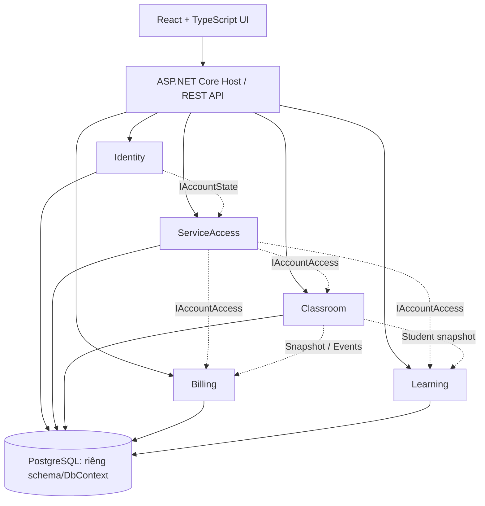
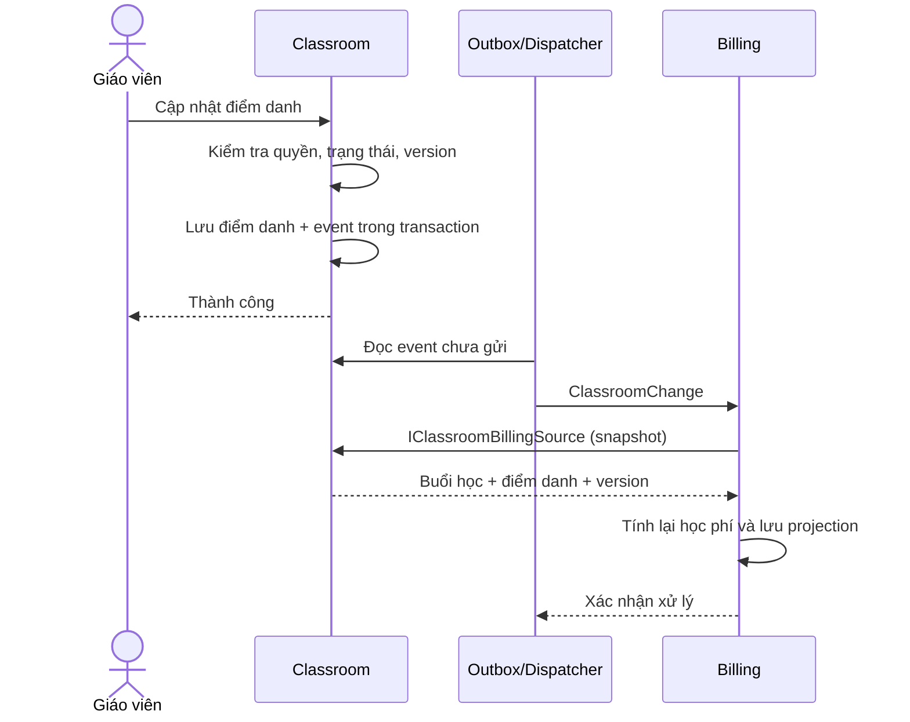
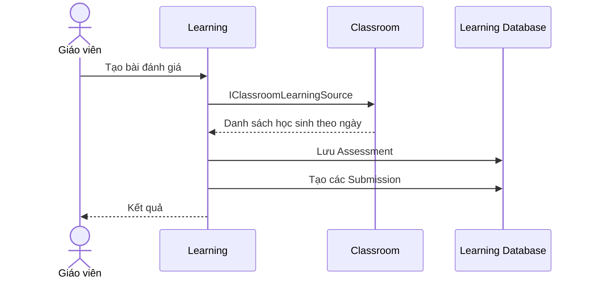
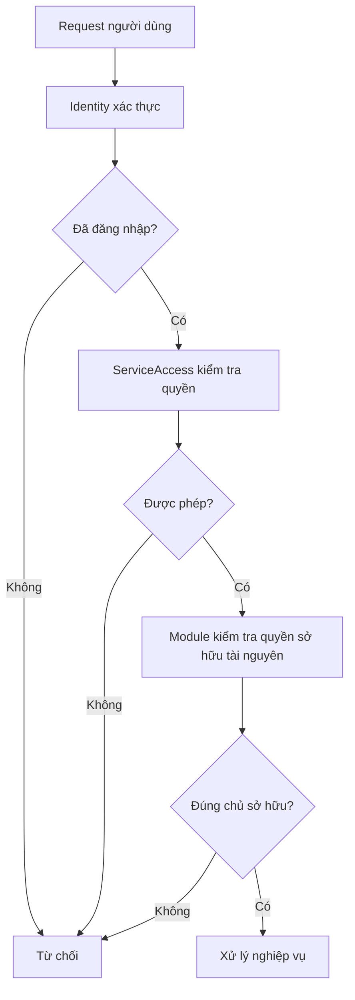

# BÁO CÁO BUỔI 2 – PHÂN TÍCH YÊU CẦU VÀ THIẾT KẾ KIẾN TRÚC HỆ THỐNG

**Đề tài:** EducationKeeptrack – Hệ thống quản lý lớp học, học sinh, học phí và kết quả học tập  
**Repository:** https://github.com/truongtoanr0602/EducationKeeptrack  
**Phạm vi:** Yêu cầu phi chức năng, thống kê module và class, cơ chế giao tiếp liên module.

> **Giới hạn xác minh:** Báo cáo tổng hợp từ phần phân tích repository ở cuộc trao đổi trước. Các interface liệt kê ở mục 3.2 đã được nêu trong tài liệu dự án; bảng nhóm class ở mục 3.3 là phân tích trách nhiệm kiến trúc, **chưa được kiểm kê trực tiếp và đầy đủ từ tất cả file `.cs`**. Các chỉ tiêu hiệu năng và độ sẵn sàng là **mục tiêu đề xuất**, chưa phải kết quả đo đạc.

## 1. Tổng quan hệ thống

EducationKeeptrack được mô tả là hệ thống theo kiến trúc **Modular Monolith**, sử dụng **ASP.NET Core/.NET 10, Entity Framework Core, PostgreSQL, React và TypeScript**. Các module nghiệp vụ cùng chạy trong một backend nhưng được tách theo trách nhiệm và quyền sở hữu dữ liệu.

Các thành phần chính:

- **Identity:** Xác thực và trạng thái tài khoản.
- **ServiceAccess:** Quyền sử dụng dịch vụ.
- **Classroom:** Lớp học, học sinh, ghi danh, lịch học, buổi học và điểm danh.
- **Billing:** Đơn giá, học phí, thanh toán, phân bổ và công nợ.
- **Learning:** Đánh giá và kết quả học tập.
- **Host:** Khởi tạo ứng dụng, cấu hình và kết nối các module.

**Nguyên tắc kiến trúc:** Các module không tùy ý đọc/ghi bảng nội bộ của nhau; dữ liệu liên module được cung cấp thông qua public contracts, snapshots và domain events.

## 2. Yêu cầu phi chức năng (NFR) – phiên bản chi tiết

Các yêu cầu cần đo lường được và có phương án kiểm thử. Ngưỡng định lượng dưới đây là **đề xuất nghiệm thu**.

| Mã | Nhóm | Yêu cầu / tiêu chí nghiệm thu |
|---|---|---|
| NFR-01 | Hiệu năng | 95% yêu cầu đọc dữ liệu thông thường ≤ 2 giây; 95% yêu cầu ghi ≤ 3 giây ở mức 50 người dùng đồng thời. |
| NFR-02 | Chịu tải | Ít nhất 50 người dùng đồng thời, tỷ lệ lỗi máy chủ < 1% trong bài kiểm thử 15 phút. |
| NFR-03 | Xác thực | API quản lý yêu cầu đăng nhập; mật khẩu lưu bằng cơ chế băm an toàn, không lưu plaintext. |
| NFR-04 | Phân quyền | Giáo viên chỉ xem/sửa lớp, học sinh, học phí và kết quả nằm trong phạm vi quyền sở hữu. |
| NFR-05 | Truyền dữ liệu an toàn | Production dùng HTTPS/TLS; cookie phiên dùng `Secure`, `HttpOnly`, `SameSite=Strict`; chống CSRF cho thao tác thay đổi dữ liệu. |
| NFR-06 | Toàn vẹn dữ liệu | Thu tiền, phân bổ công nợ và tạo sự kiện trong transaction thích hợp; lỗi không để lại trạng thái dở dang. |
| NFR-07 | Đồng thời | Có optimistic concurrency/version; cập nhật bằng version cũ trả HTTP 409 và không ghi đè âm thầm. |
| NFR-08 | Idempotency | Các nghiệp vụ tài chính sử dụng `idempotencyKey` để retry không tạo giao dịch trùng. |
| NFR-09 | Sẵn sàng | Mục tiêu uptime ≥ 99,5%/tháng (không tính bảo trì thông báo trước). |
| NFR-10 | Sao lưu/phục hồi | Đề xuất backup PostgreSQL hằng ngày, RPO ≤ 24 giờ, RTO ≤ 4 giờ; thử nghiệm khôi phục định kỳ. |
| NFR-11 | Bảo trì | Chia module theo nghiệp vụ, truy cập qua contract công khai, hạn chế phụ thuộc implementation. |
| NFR-12 | Kiểm thử | Có integration tests cho nghiệp vụ trọng yếu và end-to-end tests cho luồng giao diện chính. |
| NFR-13 | Mở rộng | Tính năng mới không phải sửa trực tiếp dữ liệu nội bộ của module không liên quan. |
| NFR-14 | Tương thích | Hỗ trợ Chrome, Edge và trình duyệt di động hiện đại; giao diện sử dụng tốt từ 360px. |
| NFR-15 | Khả dụng | Lỗi bằng tiếng Việt, chỉ rõ trường sai; giữ dữ liệu biểu mẫu khi gặp validation error hoặc conflict. |
| NFR-16 | Chính xác tài chính | Tiền tính theo VND nguyên; không dùng floating-point cho phép tính tiền; giữ nguyên độ chính xác frontend/backend. |
| NFR-17 | Truy vết | Lưu người thực hiện, thời gian, lịch sử thay đổi các thao tác điểm danh, thu tiền và đánh giá quan trọng. |
| NFR-18 | Tin cậy sự kiện | Event được lưu bền vững, hỗ trợ retry; handler phải idempotent khi nhận lại sự kiện. |
| NFR-19 | Triển khai | Có thể triển khai qua Docker Compose; secrets qua biến môi trường, không commit vào source. |
| NFR-20 | Dịch vụ bên ngoài | Tích hợp QR có timeout/fallback; lỗi dịch vụ ngoài không làm mất dữ liệu thanh toán. |

### 2.1. Ưu tiên kiểm soát

**Bảo mật và quyền sở hữu:** đăng nhập thành công không có nghĩa được đọc mọi lớp; backend phải kiểm tra quyền với từng tài nguyên.

**Toàn vẹn học phí:** thu tiền, phân bổ và cập nhật công nợ phải nhất quán trong transaction phù hợp.

**Đồng bộ event:** khi dữ liệu Billing chưa cập nhật sau thay đổi điểm danh, hệ thống nên biểu thị trạng thái đang đồng bộ, tránh coi dữ liệu cũ là kết quả cuối.

### 2.2. Kiểm thử yêu cầu phi chức năng

| Nhóm | Công cụ/phương pháp | Kết quả cần kiểm |
|---|---|---|
| Performance | k6 / JMeter | p95 latency, request/giây, tỷ lệ lỗi |
| Security | API authorization tests | Chặn truy cập ngoài quyền sở hữu |
| Concurrency | Hai cập nhật cùng version | Một thành công, cập nhật version cũ trả 409 |
| Integrity | Integration tests PostgreSQL | Rollback chính xác khi lỗi |
| Event reliability | Giả lập handler thất bại và restart | Event được gửi lại, không tạo bản ghi trùng |
| Recovery | Khôi phục backup | Đáp ứng RPO/RTO đề xuất |
| UI/UX | Playwright, kiểm thử thủ công | Responsive, form giữ dữ liệu khi lỗi |
| Deployment | Docker Compose | Dịch vụ khởi động và kết nối đúng |

## 3. Thống kê module, interface và nhóm class

### 3.1. Các module

| STT | Module | Chức năng | Dữ liệu quản lý | Giao tiếp |
|---|---|---|---|---|
| 1 | Identity | Xác thực, đăng nhập, đăng xuất, trạng thái tài khoản | User, role, credential | Cung cấp `IAccountState` |
| 2 | ServiceAccess | Kiểm tra và giới hạn quyền sử dụng | Trạng thái cấp quyền | Sử dụng `IAccountState`, cung cấp `IAccountAccess` |
| 3 | Classroom | Lớp, học sinh, ghi danh, lịch, buổi và điểm danh | Class, Student, Enrollment, Schedule, Session, Attendance | Cung cấp snapshot, phát event |
| 4 | Billing | Đơn giá, học phí, thanh toán, công nợ, điều chỉnh | TuitionRate, Fee, Receipt, Allocation, Adjustment, Hold | Nhận snapshot/event từ Classroom |
| 5 | Learning | Bài đánh giá, kết quả, phiên bản, xác nhận | Assessment, Submission, Revision | Lấy danh sách học sinh từ Classroom |
| 6 | Host | Startup, DI, middleware, API, worker | Cấu hình hệ thống | Khởi tạo các module |

> `Host` là thành phần hạ tầng, không phải module nghiệp vụ thứ sáu. Frontend React cũng là một thành phần độc lập với các module backend.

### 3.2. Interface/contract được nêu trong tài liệu

| Module cung cấp | Interface | Chức năng | Bên sử dụng |
|---|---|---|---|
| Identity | `IAccountState` | Cung cấp trạng thái tài khoản | ServiceAccess |
| ServiceAccess | `IAccountAccess` | Kiểm tra quyền đọc/ghi, quyền sử dụng | Classroom, Billing, Learning |
| Classroom | `IClassroomBillingSource` | Snapshot buổi học/điểm danh phục vụ tính phí | Billing |
| Classroom | `IClassroomChangeHandler` | Contract xử lý sự kiện thay đổi Classroom | Billing/subscriber |
| Classroom | `IClassroomLearningSource` | Danh sách học sinh theo ngày đánh giá | Learning |
| Billing | `ITuitionChangeHandler` | Contract thông báo thay đổi học phí | Subscriber |
| Learning | `ILearningResultChangeHandler` | Contract thông báo thay đổi kết quả đánh giá | Subscriber |

**Lưu ý:** Interface không phải concrete class. Cần phân loại riêng `class`, `record`, `interface`, `enum` khi thống kê số lượng thực tế.

### 3.3. Bảng class/nhóm class cần đối chiếu với mã nguồn

Các tên sau là tên biểu diễn trách nhiệm nghiệp vụ, **không khẳng định là tên class chính xác trong repository**.

| Module | Class/nhóm class minh họa | Chức năng |
|---|---|---|
| Identity | `ApplicationUser` | Thông tin tài khoản và định danh |
| Identity | Identity `DbContext` | Persistence của dữ liệu xác thực |
| ServiceAccess | Access Policy/Service | Kiểm tra quyền dịch vụ |
| ServiceAccess | Access `DbContext` | Persistence quyền sử dụng |
| Classroom | Class Entity | Lưu thông tin lớp và chủ sở hữu |
| Classroom | Student Entity | Hồ sơ học sinh |
| Classroom | Enrollment Entity | Quản lý ghi danh |
| Classroom | Schedule Entity | Lịch học và phiên bản lịch |
| Classroom | Session Entity | Trạng thái từng buổi học |
| Classroom | Attendance Entity | Điểm danh |
| Classroom | Classroom `DbContext` | Persistence dữ liệu lớp |
| Classroom | Event Dispatcher | Gửi sự kiện thay đổi lớp |
| Billing | Tuition Rate Entity | Đơn giá theo hiệu lực |
| Billing | Fee Entity | Học phí phát sinh |
| Billing | Receipt Entity | Phiếu thu |
| Billing | Payment Allocation Entity | Phân bổ khoản thu |
| Billing | Adjustment Entity | Điều chỉnh học phí |
| Billing | Billing `DbContext` | Persistence tài chính |
| Billing | Billing Projection Handler | Cập nhật học phí từ snapshot/event |
| Learning | Assessment Entity | Thông tin bài đánh giá |
| Learning | Submission Entity | Kết quả từng học sinh |
| Learning | Revision/History Entity | Lịch sử và phiên bản kết quả |
| Learning | Learning `DbContext` | Persistence đánh giá |
| Host | Startup/Composition Root | Đăng ký module, API, middleware và worker |

## 4. Các module giao tiếp như thế nào?

### 4.1. Hai cơ chế giao tiếp

1. **Đồng bộ qua interface:** Module gọi public contract để lấy dữ liệu hoặc xác thực điều kiện. Ví dụ Billing gọi `IClassroomBillingSource` để lấy snapshot buổi học.
2. **Bất đồng bộ qua sự kiện:** Module lưu và phát domain event khi có thay đổi; subscriber nhận sự kiện và cập nhật dữ liệu thuộc quyền sở hữu của mình.

Các module nằm trong cùng ứng dụng nên không nhất thiết phải gọi REST API nội bộ giữa nhau.

### 4.2. Ma trận giao tiếp

| Nguồn | Đích | Cơ chế | Mục đích |
|---|---|---|---|
| Identity | ServiceAccess | `IAccountState` | Kiểm tra trạng thái tài khoản |
| ServiceAccess | Classroom | `IAccountAccess` | Kiểm tra quyền sử dụng |
| ServiceAccess | Billing | `IAccountAccess` | Kiểm tra quyền với nghiệp vụ tài chính |
| ServiceAccess | Learning | `IAccountAccess` | Kiểm tra quyền đánh giá |
| Classroom | Billing | `IClassroomBillingSource` | Snapshot buổi/điểm danh |
| Classroom | Billing | `ClassroomChange` / `IClassroomChangeHandler` | Thông báo dữ liệu lớp thay đổi |
| Classroom | Learning | `IClassroomLearningSource` | Danh sách học sinh tại ngày đánh giá |
| Billing | Subscriber | `ITuitionChangeHandler` | Thông báo thay đổi học phí |
| Learning | Subscriber | `ILearningResultChangeHandler` | Thông báo kết quả đánh giá |

### 4.3. Luồng điểm danh → tính học phí

**Ví dụ:** Đơn giá 150.000 VND/buổi; khi học sinh được ghi nhận có mặt trong buổi đã diễn ra, Billing tính học phí tương ứng. Nếu điểm danh bị thay đổi, hệ thống tính lại theo dữ liệu mới, đồng thời bảo toàn lịch sử và quy tắc tài chính.

**Nguyên tắc:** Classroom không trực tiếp ghi bảng Billing; Billing không tùy ý truy cập bảng Classroom.

### 4.4. Luồng tạo bài đánh giá

Learning lấy snapshot từ Classroom, sau đó tự quản lý bài đánh giá và kết quả trong dữ liệu Learning.

### 4.5. Luồng kiểm tra quyền

### 4.6. Outbox, retry và idempotency

| Thành phần | Vai trò |
|---|---|
| Domain event / `ClassroomChange` | Mô tả thay đổi nghiệp vụ |
| Outbox | Lưu sự kiện bền vững cùng giao dịch dữ liệu |
| Background dispatcher | Chuyển sự kiện chưa được xử lý |
| Event handler | Cập nhật dữ liệu của module nhận |
| Event ID | Giúp tránh xử lý trùng |
| Source version | Phân biệt dữ liệu mới/cũ, tránh ghi đè sai thứ tự |

Với nguyên tắc **at-least-once delivery**, event có thể được gửi lại. Handler cần xử lý an toàn khi nhận cùng event nhiều lần.

## 5. Đánh giá kiến trúc

### 5.1. Ưu điểm

| Tiêu chí | Đánh giá |
|---|---|
| Phân chia trách nhiệm | Nghiệp vụ và quyền sở hữu dữ liệu rõ ràng |
| Độc lập dữ liệu | Schema, DbContext và migration tách theo module |
| Bảo trì | Thay đổi nội bộ module giảm tác động dây chuyền |
| Nhất quán | Transaction, version và outbox hỗ trợ bảo vệ dữ liệu |
| Kiểm thử | Có thể kiểm thử API, dữ liệu và giao tiếp module |
| Triển khai | Docker Compose giúp thống nhất môi trường |

### 5.2. Hạn chế và hướng cải tiến

| Vấn đề | Hướng cải tiến |
|---|---|
| Đồng bộ học phí có thể trễ | Hiển thị trạng thái pending và tránh quyết định dựa trên dữ liệu chưa đồng bộ |
| Event tồn đọng | Theo dõi outbox backlog, retry count và delay |
| Dịch vụ ngoài bị lỗi | Timeout, fallback, xử lý lỗi rõ ràng |
| Nguy cơ phụ thuộc vòng | Kiểm tra dependency graph/architecture tests trong CI |
| Khôi phục sau sự cố | Backup, khôi phục và diễn tập định kỳ |
| Codebase mở rộng | Chuẩn hóa code review, logging và kiểm thử kiến trúc |

## 6. Kết luận

EducationKeeptrack sử dụng kiến trúc Modular Monolith với năm module nghiệp vụ chính là Identity, ServiceAccess, Classroom, Billing và Learning. Module được tách theo trách nhiệm, quyền sở hữu dữ liệu và public contracts. Giao tiếp diễn ra qua interface/snapshot cho tác vụ đồng bộ và domain event/outbox cho tác vụ bất đồng bộ.

Báo cáo đã chuyển yêu cầu phi chức năng từ các nhận định định tính sang các **tiêu chí đo lường và phương án kiểm thử**. Khi nghiệm thu cần kiểm chứng các chỉ tiêu hiệu năng, bảo mật, độ sẵn sàng và phục hồi theo điều kiện hạ tầng thực tế.

**Việc cần bổ sung để hoàn thiện báo cáo nộp:** Quét toàn bộ source `.cs`, lập danh sách chính xác `namespace`, `class/interface/record`, phương thức public và quan hệ phụ thuộc; cập nhật bảng 3.3 để loại bỏ tên minh họa, đồng thời gắn file path từng class.

## 7. Tài liệu tham khảo

- Repository: https://github.com/truongtoanr0602/EducationKeeptrack
- README: https://github.com/truongtoanr0602/EducationKeeptrack/blob/master/README.md
